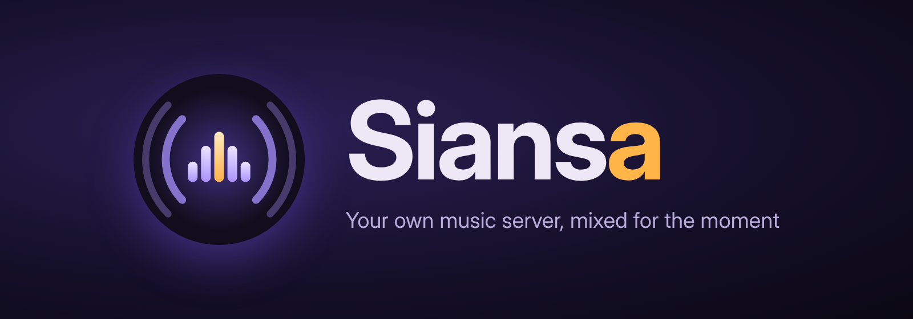
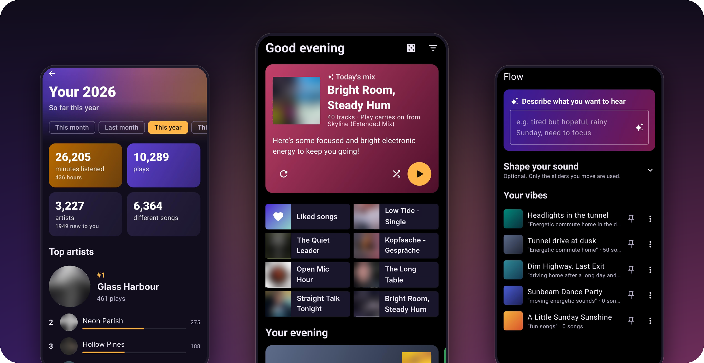
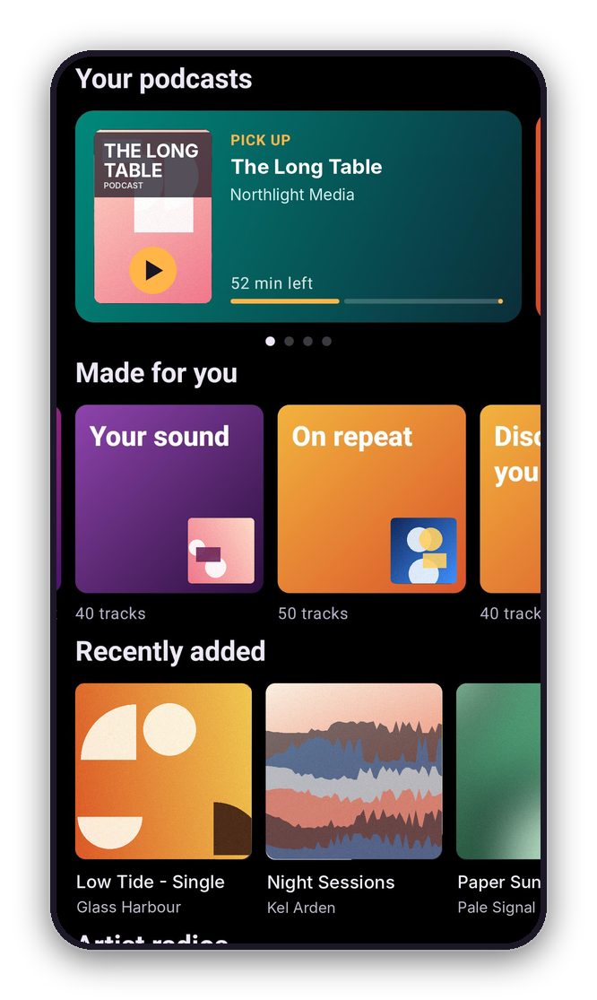
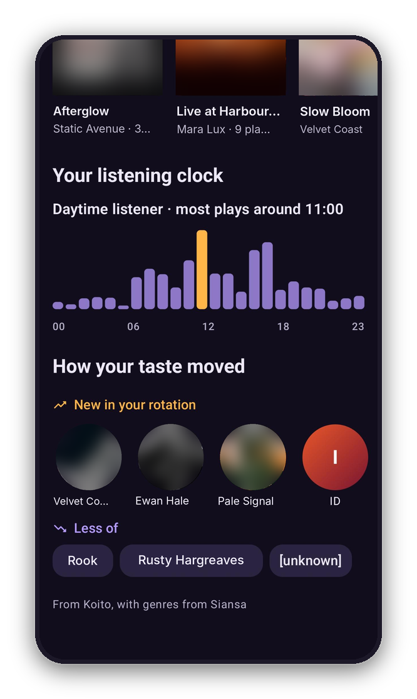
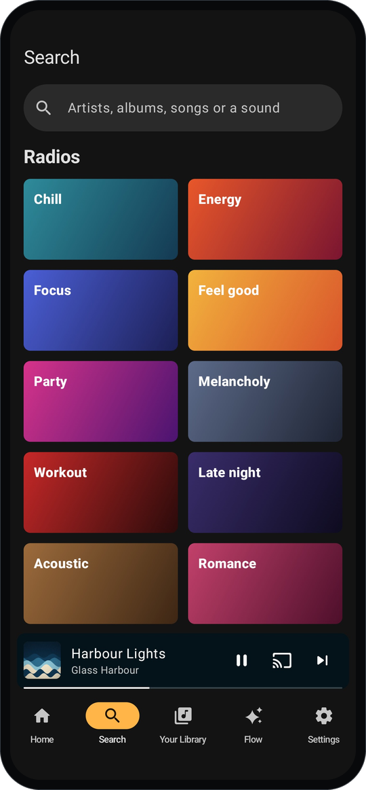
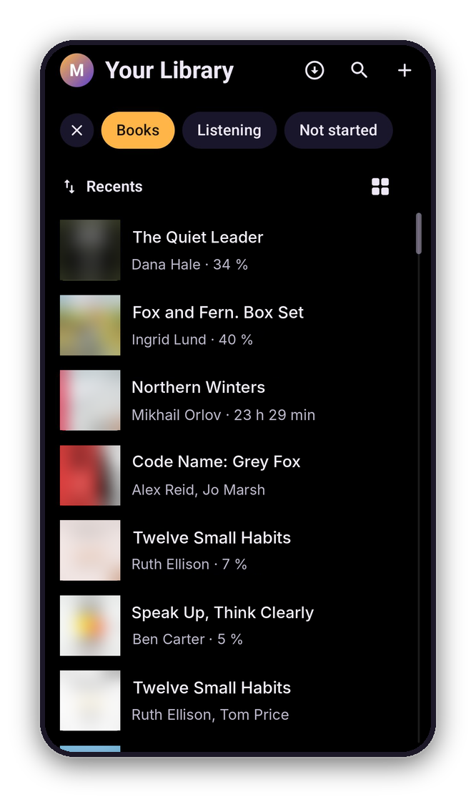
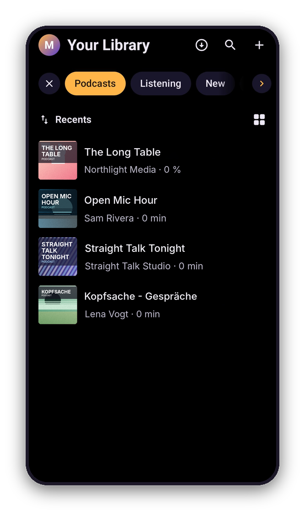
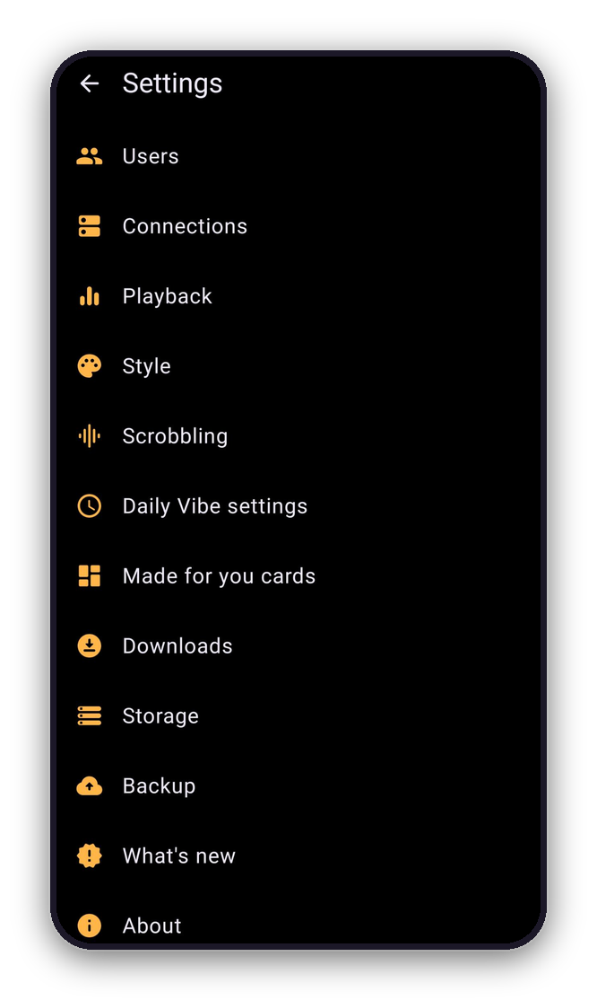

# Siansa

A music player for your own **Navidrome**, **OpenSubsonic** or **Emby** server, with daily mixes built on the phone from **AudioMuse-AI** text search and, optionally, titles and searches written by an **OpenRouter** model. Audiobooks and podcasts from **Audiobookshelf** play alongside.

Siansa is **open source** under the GNU GPL, version 3 or later ([LICENSE](LICENSE)): the code is here to read, build and improve. Website: [siansa.app](https://siansa.app). Docs: [docs.siansa.app](https://docs.siansa.app) (the [docs folder](docs/README.md) until then).

## What it does

- **Library**: albums (A–Z, recently added, most played, random), artists, album and artist pages, search.
- **Player**: background playback with notification and lock-screen controls, gapless playback, shuffle and repeat, a queue, ReplayGain (track or album, with pre-amp), and scrobbling back to Navidrome.
- **Lyrics**: synced lyrics from Navidrome's OpenSubsonic API that scroll and highlight along with the song (tap a line to jump), plain lyrics otherwise.
- **Animated covers**: animated cover.gif / cover.webp move on the album page and in now playing (lists show the first frame). An animated WebP, which Navidrome can't shrink, is downloaded once and kept on the phone.
- **Covers offline**: optionally download every album, artist and playlist cover in the background on your home Wi-Fi, with an image cache that can have no size limit.
- **Vibes and daily mixes**: each vibe covers part of the day (Morning, Daytime, Evening, Night by default). When you open the app, the vibe for the current hour builds today's mix:
  1. If AI is on, OpenRouter gets a small prompt: the vibe's guidance, its forbidden words, the day and time, the audio device (car Bluetooth, headphones…), your last 20 plays and the sound concepts AudioMuse understands. It answers with a title, a sound search and a one-line description. **Your library is never sent.**
  2. The answer is rejected if it uses a forbidden word, and the vibe's fallback search is used instead.
  3. AudioMuse's text search finds matching tracks by sound. The app picks a varied set, skips songs from recent days, limits tracks per artist and avoids the same artist twice in a row.
  4. The mix is saved **only on the phone**. Nothing is written to Navidrome's playlists.
- **Sound search**: the Search tab can also describe a sound ("rainy jazz piano") and play what AudioMuse finds.

## A look around

<table align="center">
<tr>
<td align="center" width="33%"> <b>Home</b>: podcasts, Made for you, recently added</td>
<td align="center" width="33%"> <b>Your year</b>: listening clock, how your taste moved</td>
<td align="center" width="33%"> <b>Search</b>: a sound, or a mood radio</td>
</tr>
<tr>
<td align="center"> <b>Audiobooks</b> from Audiobookshelf</td>
<td align="center"> <b>Podcasts</b>, with your progress</td>
<td align="center"> <b>Settings</b></td>
</tr>
</table>

The covers, artist pictures and names in these screenshots are made up; in the app you see your own library.

## Getting it

Siansa is in beta. There's no APK to download here: the app comes from

- **Google Play's beta**: sign up at [siansa.app](https://siansa.app), or
- the **Siansa F-Droid repository** for testers, also from [siansa.app](https://siansa.app).

Both update on their own. Or build it from this source (below): a build of your own is signed with your own key, so it can't update an installed copy from Play or F-Droid, and the other way round.

## Setup

1. In Settings, enter:
   - **Your server**: address (e.g. `http://192.168.1.10:4533`), username, password.
   - **AudioMuse-AI**: address of its web/API port (e.g. `http://192.168.1.10:8000`) and its API token if authentication is on. Text search (CLAP) must be enabled.
   - **OpenRouter** (optional): API key and model id (default `google/gemini-2.5-flash`; any OpenRouter model id works).
   - **Audiobookshelf** (optional, under Settings › Users): address and an API token or login.
2. Use **Test** next to each section, then **Save**.
3. Optional: install the **Siansa plugin** on AudioMuse-AI (see [`audiomuse-plugin/`](audiomuse-plugin/README.md)) and choose it
   under Settings › Crossfade and levelling. It measures each song's loudness and how it starts and ends, for
   levelling and smooth crossfades, and finds similar albums and artists.

Inside the app, with **Settings › Help › Debug logs** on, the log records each start (version, phone, settings that change behaviour), why the app last closed (crash, freeze, killed for memory, swiped away; Android 11+), every error in background work, playback decisions, downloads and covers. **Report a problem** on the same page sends it with your words.

## Quality checks

Every push to `main` and every pull request runs `.github/workflows/ci.yml`:

| Check | What it catches |
|---|---|
| **Build** (`assembleRelease`) | Syntax and type errors; the release APK must compile and shrink with R8. |
| **Unit tests** (`app/src/test`) | Mistakes in the app's own logic: server addresses, cover detection, ReplayGain, release types, name matching, the home-network check. Run in seconds, no phone needed. |
| **Plugin tests** (`audiomuse-plugin/tests`) | Mistakes in the AudioMuse-AI plugin: loudness against the BS.1770 reference, fade shapes, the ramp layout the app reads, similar lists and when they rebuild. |
| **Android Lint** | Likely crashes, wrong Android API use for older versions, and security issues. Errors appear as annotations on the commit. |
| **Secret scan** (gitleaks, `.gitleaks.toml`) | Passwords, tokens or API keys committed anywhere in the history. |
| **Emulator tests** (`app/src/androidTest`) | The app on an Android emulator against a real Navidrome behind a phone-speed link: animated covers downloaded once and shown as stills in lists, songs playing while covers load, and a tour of every page that plays songs from several of them. Screenshots of every page and the app's log go to the `ci-screens` branch. They run after each merge to main and nightly, not on pull requests, and report problems without holding back releases (song start times on the throttled emulator vary too much to fail on; slow starts are listed in the run). |
| **Dependabot** (`.github/dependabot.yml`) | Weekly pull requests for outdated libraries and alerts for known vulnerabilities in them. |

Every pull request, push and nightly run builds the app and runs Lint, the unit tests, the plugin tests and the secret scan, whatever changed. The emulator tests run every night, and after merges to main that can change the app. Gradle's build cache reuses unchanged work. Pull requests and the quick checks run on GitHub's runners; pushes to main, the emulator tests and releases run on the owner's own runner when the `RUNS_ON` repository variable names it (see `.github/workflows/ci.yml`).

A release is published from main when the build, Lint, unit tests and secret scan pass. A failing check shows a red cross on the commit, and its details are in the run's annotations.

Inside the app, with **Settings → Logs → Keep a log** on, the log records each start (version, phone, settings that change behaviour), why the app last closed (crash, freeze, killed for memory, swiped away; Android 11+), every error in background work, playback decisions, downloads and covers. **Problems** on the Logs page shows only warnings and errors.

## Building

GitHub Actions builds the app on every push to `main` and publishes a release once all quality checks pass. The version comes from `version.txt` (e.g. `0.0.3beta`). Each change adds a note in `changelog.d/` (see its README). When changes are merged to `main` and the checks pass, CI raises the version by the size of the change (fixes 0.1.3 → 0.1.4, new features 0.1.3 → 0.2.0, 1.0 only when asked for; see `changelog.d/README.md`), tags `v<version>` with the notes, records the section in `CHANGELOG.md` and the version in `version.txt`, sends the APK to the F-Droid repository and the app bundle to Google Play's beta (closed and internal testing). Edits to older changelog sections are copied to their releases too. `RELEASES.md` lists every release with the pull requests in it and is updated after each release.

The release signing key isn't in the repository: CI gets it from the secrets `SIGNING_KEYSTORE_BASE64`, `SIGNING_KEYSTORE_PASSWORD`, `SIGNING_KEY_ALIAS` and `SIGNING_KEY_PASSWORD`, and a build without them is unsigned.

To build locally: `gradle :app:assembleRelease` with Gradle 8.14+, JDK 17 and the Android SDK (platform 36). To sign it with a key of your own, set `SIANSA_KEYSTORE` (the file's path), `SIANSA_KEYSTORE_PASSWORD`, `SIANSA_KEY_ALIAS` and `SIANSA_KEY_PASSWORD` in the environment.

## Contributing and reporting

Bug reports and feature requests go in this repository's [issues](issues), or **Settings › Help › Report a problem** in the app, which sends the log along. Pull requests are welcome here: one issue per pull request, with a note in `changelog.d/` and tests for what changes (see `CLAUDE.md` for the conventions CI checks).

## Licence

Siansa is free software under the [GNU General Public License, version 3 or later](LICENSE). The AudioMuse-AI plugin in `audiomuse-plugin/` is under the [AGPL 3](audiomuse-plugin/LICENSE), as AudioMuse-AI is. The libraries the app is built on and their licences are listed at [siansa.app/licenses](https://siansa.app/licenses).
