# Siansa

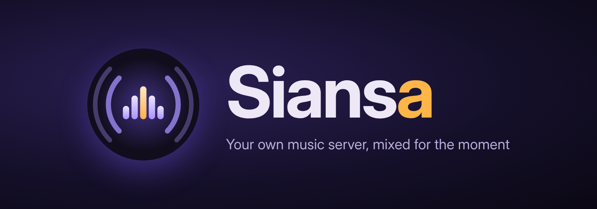

A music player for your own music server (**Navidrome** or another **OpenSubsonic** server, **Jellyfin** or **Emby**), on
Android phones, Android Auto and Android TV. Mixes are made for the moment by **AudioMuse-AI**'s sound search, for the
time of day, the weather or a mood you describe, and named by an AI service of your choice. Songs blend like a DJ's set.
Audiobooks and podcasts from **Audiobookshelf** play alongside.

Siansa is **open source** under the GNU GPL, version 3 or later ([LICENSE](LICENSE)). Website: [siansa.app](https://siansa.app).
Docs: the [docs folder](docs/README.md), later at docs.siansa.app.

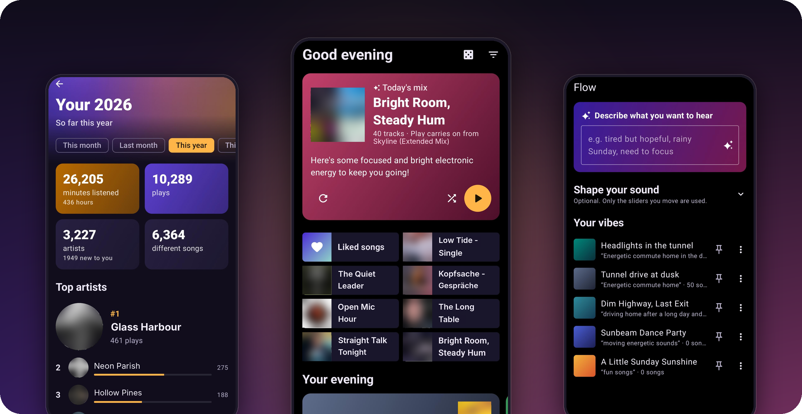

## Get Siansa

&nbsp;

- **Google Play**, in testing: [join the testers](https://siansa.app/#join). Google asks a new app for 12 testers over
  14 days before it opens to everyone, so every tester helps bring Siansa to Google Play for free, for everyone.
- **F-Droid**, open to everyone: in the F-Droid app, **Settings › Repositories › +**, add `https://siansa.app/fdroid/repo`.
- **On your TV**: the same app, from either store on an Android TV or Google TV. See [Siansa on your TV](docs/tv.md).

There's no APK to download here: Siansa comes from Google Play and its F-Droid repository, which both update it.

## What you need

For the best of Siansa: a music server, [AudioMuse-AI](https://github.com/NeptuneHub/AudioMuse-AI) with the Siansa
plugin, and [Last.fm](https://www.last.fm) or [Koito](https://github.com/gabehf/Koito) for your listening history. An AI
service such as [OpenRouter](https://openrouter.ai) is optional: it names your mixes. See
[Getting started](docs/getting-started.md).

## What it does

- **Mixes made for the moment**: today's mix for each part of the day, your own carousel of mixes, Made for you, and
  Flow, where you describe a sound and steer it with dials.
- **Radios and discovery**: song, artist, mood and genre radios, Keep playing, Song path from one song to another,
  similar albums and artists, search by sound, and the dice.
- **Slide for what's next**: slide from the play button for a DJ mix, a radio, a song path or songs that sound alike.
- **DJ blends**: smart crossfades from each song's measured ends, and beat-matched blends phrase on phrase, with a
  bass swap. A DJ mix of any album, too.
- **A careful player**: gapless, levelling from measured loudness, an equaliser, synced lyrics word by word, a song
  cache, downloads and offline play.
- **TVs, speakers and the car**: Chromecast with Siansa's own TV screen, DLNA, Android Auto, and an Android TV app with
  Dolby and DTS passthrough.
- **Your listening**: your month and year, Time Machine for any month you played, and scrobbling to Last.fm,
  ListenBrainz or Koito.
- **Audiobooks, podcasts and radio**: Audiobookshelf, internet radio and podcast feeds.
- **Home your way**: arrange, restyle and hide every section, and cards of your own built from rules or a sound.

## A look around

<table align="center">
<tr>
<td align="center" width="33%">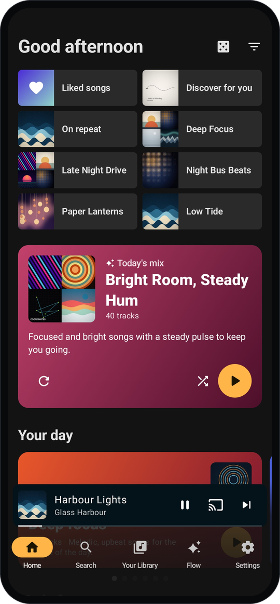 <b>Home</b>: a mix for each part of the day</td>
<td align="center" width="33%">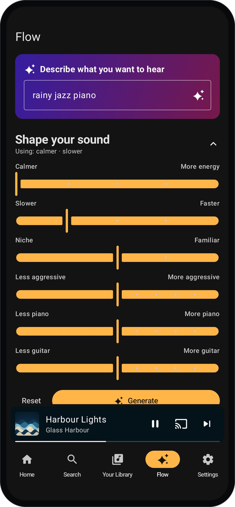 <b>Flow</b>: describe a sound, set the dials</td>
<td align="center" width="33%">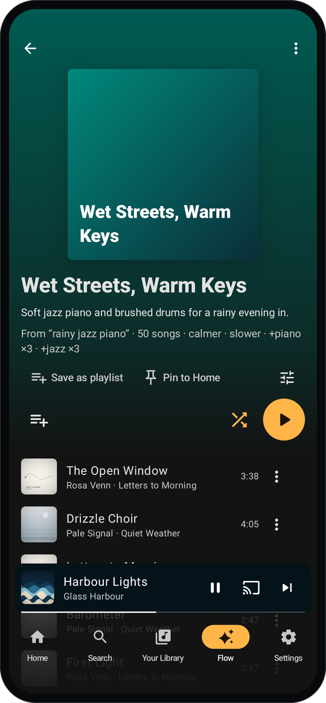 <b>The vibe</b> it makes, named by AI</td>
</tr>
<tr>
<td align="center">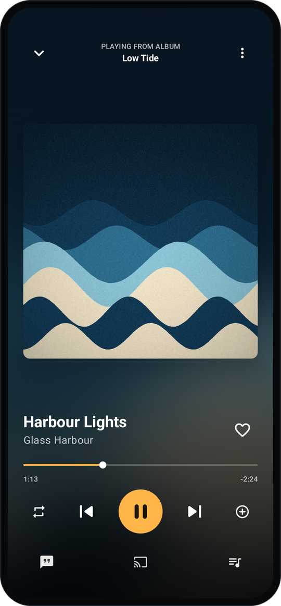 <b>Now playing</b></td>
<td align="center">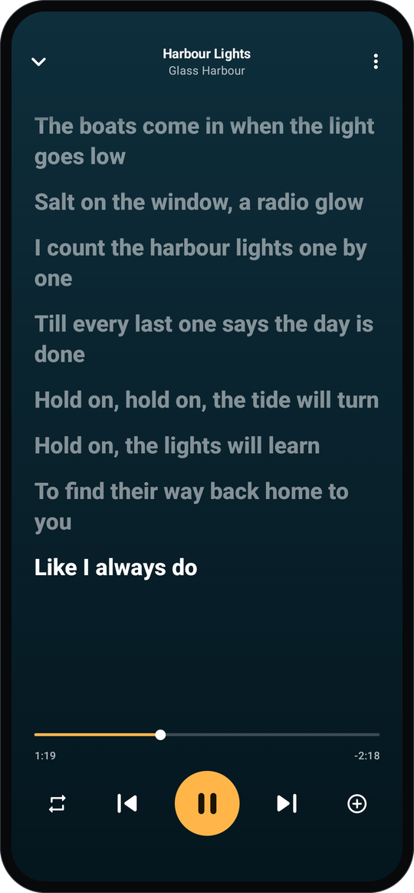 <b>Synced lyrics</b>, line by line</td>
<td align="center">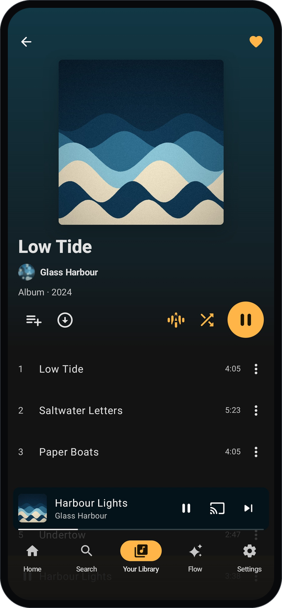 <b>An album</b></td>
</tr>
<tr>
<td align="center">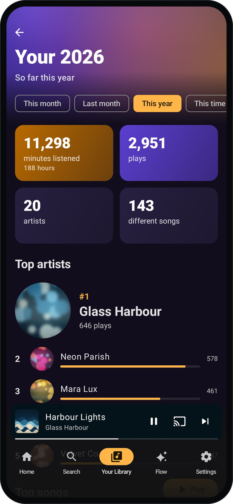 <b>Your year</b> in numbers</td>
<td align="center">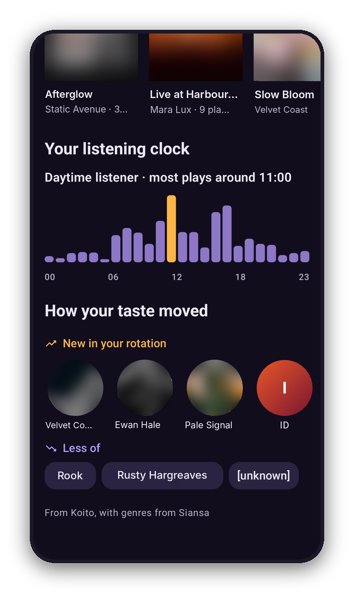 <b>Listening clock</b>, how your taste moved</td>
<td align="center">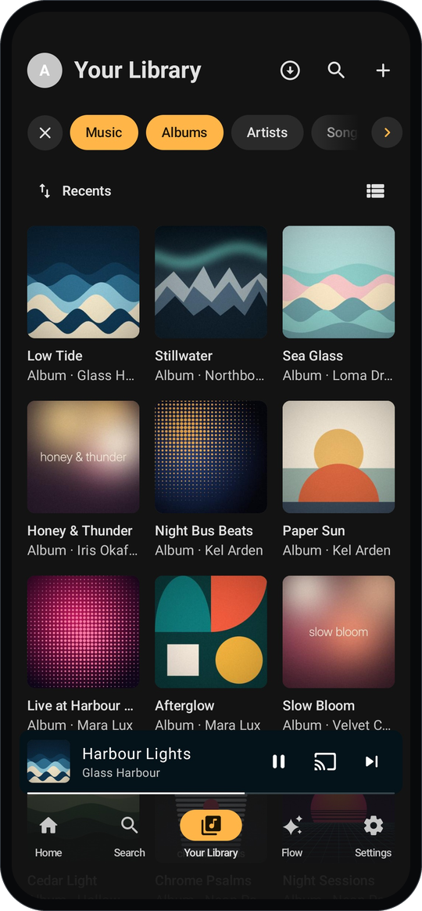 <b>Your Library</b></td>
</tr>
<tr>
<td align="center">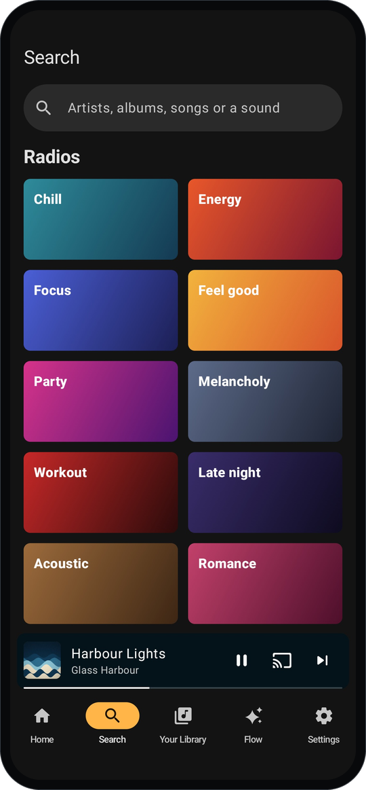 <b>Search</b>: a sound, or a mood radio</td>
<td align="center">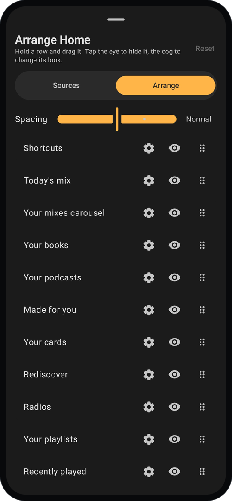 <b>Arrange Home</b> your way</td>
<td align="center">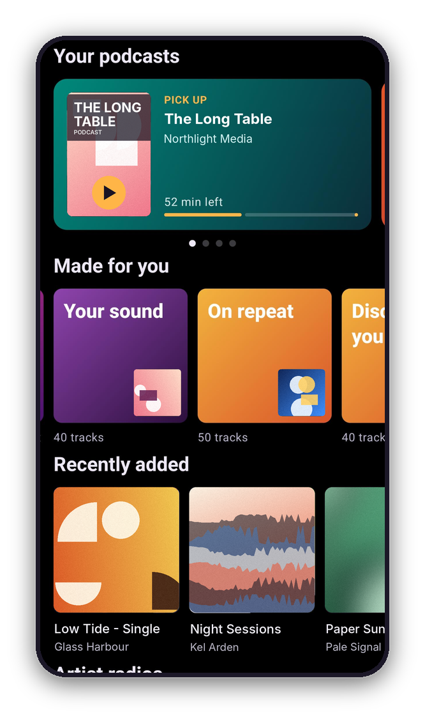 <b>More of Home</b>: genres, random picks</td>
</tr>
</table>

The covers, artist pictures and names in these screenshots are made up; in the app you see your own library.

## Building

`gradle :app:assembleRelease` with Gradle 8.14+, JDK 17 and the Android SDK (platform 36); `:tv:assembleRelease` for the
TV app. A build is unsigned unless `SIANSA_KEYSTORE` (the file's path), `SIANSA_KEYSTORE_PASSWORD`, `SIANSA_KEY_ALIAS`
and `SIANSA_KEY_PASSWORD` point at a key of your own. A build of your own can't update a copy from Google Play or
F-Droid, and the other way round.

Every pull request runs the build, Lint, the unit and screenshot tests, the secret scan, and the tests against real
Navidrome, Emby and Jellyfin servers. The emulator tests run after merges and nightly. Each change adds a note in
`changelog.d/`; merging to `main` releases it to F-Droid and Google Play. See `CLAUDE.md` for the conventions.

## Contributing and reporting

Bug reports and ideas go in this repository's [issues](issues), or **Settings › Help › Report a problem** in the app,
which sends the log along. Pull requests are welcome: one issue each, with a note in `changelog.d/` and tests for what
changes. New features go to the `dev` branch, fixes to `main`.

## Licence

Siansa is free software under the [GNU General Public License, version 3 or later](LICENSE). The AudioMuse-AI plugin in
`audiomuse-plugin/` is under the [AGPL 3](audiomuse-plugin/LICENSE), as AudioMuse-AI is. The libraries the app uses and
their licences are at [siansa.app/licenses](https://siansa.app/licenses).
